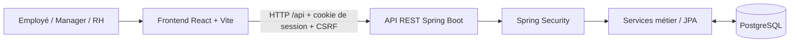
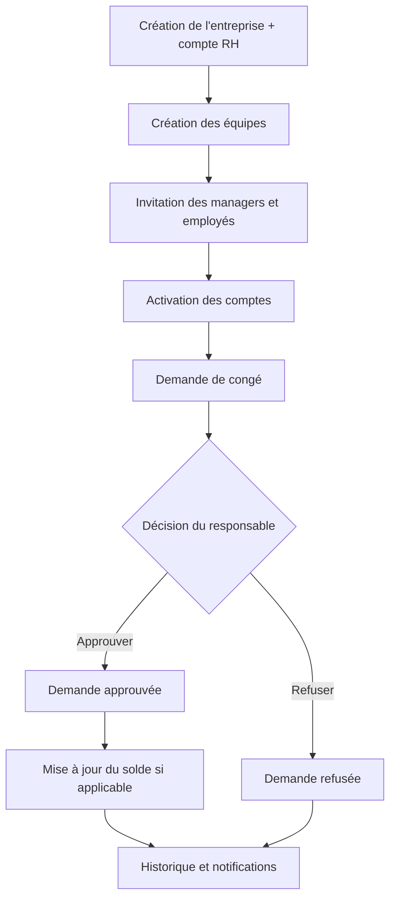

<div align="center">


# LeaveFlow

### La gestion des congés, simplifiée pour toute l'entreprise.

**Application web de gestion des congés et des absences** destinée aux collaborateurs, managers et responsables RH, avec validation des demandes, suivi des soldes et gestion des équipes au sein d'un espace centralisé.

[](front-end/package.json)
[](front-end/package.json)
[](back-end/pom.xml)
[](back-end/pom.xml)
[](back-end/src/main/resources/application.properties)

[Présentation](#-présentation) · [Fonctionnalités](#-fonctionnalités) · [Installation](#-installation-et-démarrage) · [API](#-aperçu-de-lapi) · [Tests](#-scénario-de-test)

</div>

---

## 🎯 Présentation

**LeaveFlow** digitalise le cycle de gestion des congés, depuis l'envoi d'une demande jusqu'à la décision de validation et la mise à jour du solde.

L'application propose des espaces adaptés aux responsabilités de chaque profil :

| Profil | Responsabilités principales |
|:--|:--|
| **Employé** | Déposer, consulter, modifier ou annuler ses demandes ; consulter son calendrier, ses soldes et ses notifications. |
| **Manager** | Suivre son équipe, consulter et traiter les demandes relevant de son périmètre, accéder à ses indicateurs. |
| **RH** | Administrer l'entreprise, les équipes et les collaborateurs ; gérer les invitations, les validations, les soldes et les statistiques globales. |

### Objectifs

- **Centraliser** les demandes de congé et leur historique.
- **Structurer** le circuit de validation selon les rôles.
- **Fiabiliser** les soldes à travers des données persistées en base.
- **Améliorer la visibilité** sur les absences grâce aux tableaux de bord et au calendrier.

## ✨ Fonctionnalités

| Domaine | Capacités présentes dans le projet |
|:--|:--|
| **Authentification** | Création d'un espace entreprise et d'un compte RH, connexion, déconnexion, activation par invitation. |
| **Demandes de congé** | Création, consultation, modification, annulation, approbation et refus avec commentaire. |
| **Gestion RH** | Gestion des équipes, affectation des collaborateurs, invitations, activation/désactivation des comptes. |
| **Soldes** | Solde individuel, suivi des mouvements et ajustement par le RH. |
| **Suivi** | Tableau de bord, calendrier des absences, historique et notifications. |
| **Statistiques** | Indicateurs selon le rôle et export CSV des demandes côté RH. |
| **Profil** | Consultation et modification des informations personnelles et du mot de passe. |
| **Paramètres** | Politique de congés annuels et consultation des types définis côté backend. |

> **Note fonctionnelle :** certaines fonctionnalités, notamment la réinitialisation du mot de passe par email et l'envoi réel des justificatifs, ne sont **pas encore implémentées**. Voir [Limites actuelles](#-limites-actuelles-et-améliorations).

## 🧱 Stack technique

| Couche | Technologies |
|:--|:--|
| **Frontend** | React 18, Vite 6, React Router 6, Lucide React, CSS |
| **Backend** | Java 21, Spring Boot 4.1, Spring MVC, Spring Data JPA, Bean Validation |
| **Sécurité** | Spring Security, BCrypt, `UserDetailsService`, sessions HTTP, protection CSRF |
| **Base de données** | PostgreSQL, Hibernate / JPA |
| **Gestion de projet** | Maven Wrapper pour le backend, npm pour le frontend, Git/GitHub |

### Architecture



En développement, **Vite transfère les requêtes `/api` vers Spring Boot**. L'authentification utilise une **session HTTP** (`JSESSIONID`), et non un token JWT.

## 📁 Structure du projet

```text
Gestion_Congee/
├── front-end/
│   ├── src/
│   │   ├── components/       # Composants réutilisables et navigation
│   │   ├── context/          # Etat global et chargement des données
│   │   ├── pages/            # Pages RH, Manager et Employé
│   │   ├── services/         # Client API et authentification
│   │   ├── images/           # Identité visuelle
│   │   └── App.jsx           # Routage et accès selon le rôle
│   ├── package.json
│   └── vite.config.js
├── back-end/
│   ├── src/main/java/gestionconges/
│   │   ├── config/           # Configuration Spring Security
│   │   ├── controller/       # Points d'entrée REST
│   │   ├── dto/              # Données des requêtes
│   │   ├── entity/           # Entités JPA
│   │   ├── enums/            # Rôles, types et statuts
│   │   ├── repository/       # Accès à PostgreSQL
│   │   ├── service/          # Logique métier
│   │   └── exception/        # Gestion des erreurs
│   ├── src/main/resources/
│   │   └── application.properties
│   ├── src/test/            # Tests Java présents dans le dépôt
│   ├── pom.xml
│   └── mvnw.cmd
├── Gestion_des_Conges_JavaEE.docx
└── README.md
```

## 🚀 Installation et démarrage

### 1. Prérequis

Installer les outils suivants :

- **Java JDK 21** (`java -version`)
- **Node.js 20+** et **npm** (`node -v` et `npm -v`)
- **PostgreSQL** (port `5432` par défaut) et, si souhaité, **pgAdmin 4**
- **Git** pour cloner le dépôt

Le premier lancement nécessite une connexion Internet pour récupérer les dépendances npm et Maven.

### 2. Cloner le dépôt

```bash
git clone https://github.com/sara-zarrad/Gestion_Congee.git
cd Gestion_Congee
```

### 3. Créer la base PostgreSQL

Dans **pgAdmin** : `Servers → PostgreSQL → Databases → Create → Database` puis créer :

```text
gestion_conges
```

Ou exécuter dans une session SQL connectée à une autre base :

```sql
CREATE DATABASE gestion_conges;
```

La configuration attendue se trouve dans `back-end/src/main/resources/application.properties` :

```properties
spring.datasource.url=${DB_URL:jdbc:postgresql://localhost:5432/gestion_conges}
spring.datasource.username=${DB_USER:postgres}
spring.datasource.password=${DB_PASSWORD:}
spring.jpa.hibernate.ddl-auto=update
```

| Variable | Valeur par défaut | Utilité |
|:--|:--|:--|
| `DB_URL` | `jdbc:postgresql://localhost:5432/gestion_conges` | URL de connexion JDBC |
| `DB_USER` | `postgres` | Utilisateur PostgreSQL |
| `DB_PASSWORD` | Vide | Mot de passe de l'utilisateur PostgreSQL, à fournir localement |

> **Sécurité :** ne pas enregistrer le mot de passe PostgreSQL dans le dépôt. Définir `DB_PASSWORD` dans votre terminal ou dans la configuration d'exécution locale.

### 4. Démarrer le backend

**Windows — PowerShell** (depuis le dossier racine du projet) :

```powershell
cd back-end
$env:DB_PASSWORD="VOTRE_MOT_DE_PASSE_POSTGRES"
.\mvnw.cmd spring-boot:run
```

**Linux / macOS** :

```bash
cd back-end
export DB_PASSWORD='VOTRE_MOT_DE_PASSE_POSTGRES'
./mvnw spring-boot:run
```

Le serveur est accessible par défaut sur **http://localhost:8080**. Avec `ddl-auto=update`, Hibernate crée ou actualise les tables correspondant aux entités JPA lorsque la connexion à PostgreSQL fonctionne.

### 5. Démarrer le frontend

Ouvrir **un second terminal** à la racine du projet :

```bash
cd front-end
npm ci
npm run dev
```

Ouvrir **http://localhost:5173** dans le navigateur.

| Service | Adresse locale |
|:--|:--|
| **Interface React** | http://localhost:5173 |
| **API Spring Boot** | http://localhost:8080/api |
| **PostgreSQL** | `localhost:5432` |

> Pour utiliser l'interface React en mode développement, accéder au **port 5173**. Le proxy configuré dans `front-end/vite.config.js` transmet `/api` au backend sur le port 8080.

## 🔄 Parcours utilisateur



Les jours sont déduits du solde **selon le type de congé et les règles métier**. Le type *Maladie*, par exemple, ne suit pas la même règle de déduction que les *Congés payés*.

## 🔐 Authentification et autorisations

L'authentification est gérée côté backend par **Spring Security** :

- `SecurityFilterChain` définit les accès aux ressources protégées.
- `AuthenticationManager` vérifie les identifiants.
- `CustomUserDetailsService` charge l'utilisateur depuis PostgreSQL.
- `BCryptPasswordEncoder` sécurise les mots de passe stockés.
- La session HTTP est conservée au moyen d'un cookie `JSESSIONID`.
- Les opérations d'écriture nécessitent un **token anti-CSRF** (`X-XSRF-TOKEN`).
- Les routes et services contrôlent les autorisations métier selon les profils **RH**, **MANAGER** et **EMPLOYE**.

Cette implémentation utilise **des sessions**, pas JWT. Elle reprend les composants Spring Security montrés dans le support pédagogique, dont l'exemple est fondé sur `formLogin`.

## 🔌 Aperçu de l'API

| Domaine | Exemples d'endpoints |
|:--|:--|
| **Authentification** | `POST /api/auth/login` · `GET /api/auth/me` · `POST /api/auth/logout` · `GET /api/auth/csrf` |
| **Inscription / invitations** | `POST /api/auth/register` · `GET /api/auth/invitation` · `POST /api/auth/activer-invitation` |
| **Demandes** | `GET /api/demandes` · `POST /api/demandes` · `GET /api/demandes/mes-demandes` |
| **Décisions** | `POST /api/demandes/{id}/approuver` · `POST /api/demandes/{id}/refuser` |
| **Organisation** | `/api/equipes` · `/api/utilisateurs` · `/api/invitations` |
| **Soldes** | `GET /api/soldes/mon-solde` · `POST /api/soldes/ajuster` |
| **Notifications** | `GET /api/notifications` · `POST /api/notifications/{id}/lire` |
| **Statistiques** | `GET /api/statistiques` · `GET /api/statistiques/export-csv` |

Les endpoints protégés nécessitent une session valide. Les requêtes qui modifient les données doivent également inclure le token CSRF. Voir les contrôleurs dans [`back-end/src/main/java/gestionconges/controller`](back-end/src/main/java/gestionconges/controller) pour le détail des paramètres.

## 🧪 Scénario de test

Pour valider le parcours de bout en bout :

1. **RH :** créer une entreprise et son compte administrateur RH.
2. **RH :** créer une équipe puis inviter un manager et un employé.
3. **Invités :** activer chaque compte via son lien d'invitation, puis se connecter.
4. **Employé :** créer une demande de congé sur une période future.
5. **Manager ou RH habilité :** approuver ou refuser la demande avec un commentaire.
6. **Employé :** consulter le statut, les notifications et, en cas d'approbation déductible, le solde actualisé.
7. **RH :** consulter l'historique, les statistiques et les soldes de l'entreprise.
8. **Persistance :** actualiser l'application et vérifier les informations dans **pgAdmin → gestion_conges → Schemas → public → Tables**.

### Commandes de vérification

```powershell
# Frontend (depuis front-end/)
npm run build

# Backend (depuis back-end/, sous Windows)
.\mvnw.cmd test
```

> **État de validation :** les contrôles syntaxiques du frontend ont été effectués lors de l'intégration. La compilation complète, les tests Maven et les tests de bout en bout sur PostgreSQL restent à exécuter localement. Ne pas interpréter les commandes ci-dessus comme des tests déjà réussis.

## 🛠️ Résolution des problèmes courants

| Symptôme | Vérifications |
|:--|:--|
| **`Connection refused` sur 5432** | Le service PostgreSQL est-il démarré ? Le port et le nom de base sont-ils corrects ? |
| **`password authentication failed`** | Vérifier `DB_PASSWORD` et le compte `postgres`. |
| **`ECONNREFUSED 127.0.0.1:8080`** | Démarrer le backend avant de tester les appels API du frontend. |
| **401 Non authentifié** | Refaire la connexion ; vérifier que le cookie de session est conservé. |
| **403 Accès interdit** | Vérifier le rôle, le périmètre de l'utilisateur et le token CSRF. |
| **Table absente dans pgAdmin** | Vérifier le démarrage Spring Boot, puis actualiser `Schemas → public → Tables`. |
| **`npm` ou `java` non reconnu** | Vérifier l'installation des outils et leur présence dans le `PATH`. |

## 🚧 Limites actuelles et améliorations

**Fonctionnalités à compléter :**

- **Mot de passe oublié :** le backend ne dispose pas encore d'envoi d'email ni de lien de réinitialisation opérationnel (`501 Not Implemented`).
- **Justificatifs :** le nom du document peut être conservé, mais l'envoi et le stockage d'un vrai fichier ne sont pas implémentés.
- **Types de congé :** définis dans l'énumération Java ; ils ne sont pas administrables depuis l'interface.
- **Déploiement :** la configuration présente est adaptée au développement local ; un déploiement public nécessite notamment HTTPS, une gestion sécurisée des secrets, des migrations de base et une validation complète des tests.

**Pistes d'évolution :** tests d'intégration automatisés, stockage sécurisé des justificatifs, notifications par email, documentation OpenAPI/Swagger et automatisation du déploiement.

## 🤝 Contribution et versionnement

Le projet est hébergé sur [GitHub — Gestion_Congee](https://github.com/sara-zarrad/Gestion_Congee).

Après modification locale :

```bash
git add .
git commit -m "docs: improve project README"
git push origin main
```

Ne jamais versionner de mots de passe, dossiers `node_modules/`, builds (`dist/`, `target/`) ni données PostgreSQL.

---

<div align="center">

**LeaveFlow** · Projet de gestion des congés · React + Spring Boot + PostgreSQL

</div>
